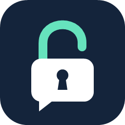

<p align="center">
  
</p>

<h1 align="center">Unblock Discord</h1>

<p align="center">Discord için Windows üzerinde DPI engeli aşma · Discord-only DPI bypass for Windows</p>

<p align="center">
  
  
  
  <a href="https://github.com/alperenkaptan/UnblockDiscord/releases"></a>
</p>

[Türkçe](#türkçe) · [English](#english) · [Technical details](docs/TECHNICAL.md) · [Report a problem](https://github.com/alperenkaptan/UnblockDiscord/issues/new/choose)

## Türkçe

Türkiye'deki Discord erişim engelleri için küçük bir Windows sistem tepsisi uygulaması. **Start** ile çalışır, **Stop** ile durur. Discord'un masaüstü uygulaması, güncelleyicisi ve kurulum klasöründeki yardımcı işlemleri için tasarlandı.

### Neler yapar?

- **ByeDPI** ile DPI aşma teknikleri uygular; **ProxiFyre** ile yalnızca Discord klasöründeki uygulamaların TCP/UDP trafiğini seçer.
- Discord bağlantılarındaki hatalı DNS adreslerini yerel bir röle içinde DNS over HTTPS kullanarak düzeltir. Windows DNS, hosts ve sistem proxy ayarlarını değiştirmez.
- Discord'un yeni `app-*` sürüm klasörlerini ve `Update.exe` güncelleyicisini aynı klasör kuralıyla kapsar.
- Çalışırken sistem tepsisine küçülür. Simgeye tıklayınca pencere tekrar açılır.
- Stop, normal çıkış veya uygulamanın zorla kapatılması bypass işlemlerini sonlandırır. Kurulu paket filtresi sürücüsü sistemde kalır.

### Kurulum ve kullanım

1. Windows 10/11 **x64** ve [.NET 10 Desktop Runtime](https://dotnet.microsoft.com/en-us/download/dotnet/10.0) kullanın.
2. Windows Packet Filter sürücüsü ile x64 Visual C++ çalışma zamanı gerekir. Eksikse [resmî ProxiFyre kurulumunu](https://github.com/wiresock/proxifyre/releases/tag/v2.6.4) kullanın. Başka bir bypass veya ProxiFyre hizmeti aynı anda çalışmasın.
3. [Releases](https://github.com/alperenkaptan/UnblockDiscord/releases) sayfasında paket varsa ZIP'i tamamen çıkartın. Paket yoksa aşağıdaki derleme adımlarını kullanın. `engines` klasörünü EXE'nin yanında tutun.
4. `UnblockDiscord.exe` dosyasını çalıştırın, yönetici iznini onaylayın ve **Start** düğmesine basın. Uygulama üç stratejiyi sırayla deneyerek herkese açık Discord uç noktalarını kontrol eder.
5. Discord zaten açıksa tamamen kapatıp yeniden açın. Durdurmak için tepsi simgesine tıklayıp **Stop** düğmesine basın veya pencereyi kapatın.

### İnternet sağlayıcısı önemli mi?

**Evet.** Türk Telekom, TurkNet, Superonline, Vodafone ve diğer sağlayıcıların DNS/DPI uygulamaları farklı olabilir. Aynı sağlayıcının farklı bağlantılarında da sonuç değişebilir.

Bu sürümün HTTPS erişimi, DNS düzeltmesi, UDP iletimi ve işlem ayrımı bir **Türk Telekom** bağlantısında test edildi. Diğer sağlayıcılarda çalışabilir; henüz doğrulanmadı. Start'ın başarılı olması ses, video veya ekran paylaşımının tamamının çalıştığını kanıtlamaz.

VPN değildir; genel IP adresinizi veya ülkenizi değiştirmez. DNS sorguları Cloudflare'a gönderilir. Hesabın hiçbir zaman işaretlenmeyeceği, her engelin aşılacağı veya sıfır ek yük garantisi yoktur.

## English

A small Windows tray app for Discord access restrictions in Turkey. Click **Start** to enable the bypass and **Stop** to stop it. It targets Discord desktop, its updater, and helpers inside its installation folder.

### What it does

- **ByeDPI** performs the DPI bypass. **ProxiFyre** selects TCP/UDP traffic from Discord's installation folder.
- A local relay corrects poisoned DNS addresses inside Discord HTTPS connections using DNS over HTTPS. System DNS, the hosts file and system proxy settings stay unchanged.
- A folder rule covers `Update.exe` and new `app-*` versions without hardcoding a version number.
- The app hides to the tray while running. Click its icon to reopen the Start/Stop window.
- Stop, normal exit and forced termination stop the bypass engines. The previously installed packet-filter driver stays installed.

### Requirements and quick start

1. Use Windows 10/11 **x64** with the [.NET 10 Desktop Runtime](https://dotnet.microsoft.com/en-us/download/dotnet/10.0).
2. Install Windows Packet Filter and the x64 Visual C++ runtime if missing, using the [official ProxiFyre setup](https://github.com/wiresock/proxifyre/releases/tag/v2.6.4). Keep its service and other bypass tools stopped while using this app.
3. If a ZIP is available on [Releases](https://github.com/alperenkaptan/UnblockDiscord/releases), extract it completely. Otherwise build from source below. Keep `engines` beside the EXE.
4. Run `UnblockDiscord.exe`, accept the administrator prompt, and click **Start**. The app tries up to three strategies against public Discord endpoints before enabling routing.
5. Fully quit and reopen Discord if it was already running. To stop, click the tray icon and press **Stop**, or close the form.

### Does my internet provider matter?

**Yes.** Providers can apply different DNS and DPI blocking. Results can also differ between connections on the same provider.

| Provider | Verification status |
| --- | --- |
| Türk Telekom | HTTPS, poisoned-DNS correction, UDP forwarding, process isolation and cleanup tested on one connection |
| TurkNet, Superonline, Vodafone and others | Not verified; the included strategies may or may not work |

The app does not select a configuration by provider name. It tests the included strategies on your current connection. A successful Start checks public HTTPS endpoints; real voice/video/screen-sharing sessions still need separate testing.

### Scope and limits

Only the default stable installation at `%LOCALAPPDATA%\Discord\` is selected. Games, browsers, other `Update.exe` programs, Canary/PTB and helpers outside that folder remain outside the rule.

Traffic uses your existing public IP and connection. There is no remote VPN server. Cloudflare receives the Discord DNS queries used for correction. The app does not patch Discord, inject DLLs, install certificates or automate login.

This is experimental. NXDOMAIN responses, hidden TLS hostnames (ECH), direct IP blocking and some IPv6 fragmentation cases are outside its coverage. There is some local proxy/driver overhead. No account-safety or universal-bypass guarantee is made. See [technical details and test boundaries](docs/TECHNICAL.md).

## Build from source

Requires the **.NET 10 SDK** on Windows:

```powershell
git clone https://github.com/alperenkaptan/UnblockDiscord.git
cd UnblockDiscord
dotnet build UnblockDiscord.slnx -c Release
```

Run `bin\Release\net10.0-windows\UnblockDiscord.exe`. The build copies the bundled `engines` folder automatically. Administrator rights and the packet-filter prerequisites are needed to run the bypass.

To create a folder for distribution (requires the Desktop Runtime on the receiving PC):

```powershell
dotnet publish UnblockDiscord.csproj -c Release --self-contained false -o artifacts/UnblockDiscord-win-x64
```

Zip the **entire** published folder, including `engines`. It is not a standalone single EXE.

## Tests

```powershell
dotnet build tests/UnblockDiscord.Tests.csproj -c Release
.\tests\bin\Release\net10.0-windows\UnblockDiscord.Tests.exe
```

Optional `--network --driver` tests route only the test executable and contact public endpoints. They require the driver; some assertions specifically expect a blocked Türk Telekom connection. Read [test details](docs/TECHNICAL.md#verification) before running them elsewhere.

## Troubleshooting and reports

- **Discord stays disconnected:** fully quit Discord, start the bypass, then reopen Discord. Confirm another bypass or ProxiFyre service is not running.
- **Start fails:** check the driver/runtime prerequisites and report the exact message. None of the three included strategies may work on your connection.
- **Text works but voice does not:** HTTPS success does not verify the voice path. Report the provider, connection type and whether voice is stuck on RTC Connecting.
- **Different install folder:** this version supports only the default stable Discord installation.

[Open a bug report](https://github.com/alperenkaptan/UnblockDiscord/issues/new/choose) with your Windows version, ISP, app version, connection type and affected feature. Remove tokens, email addresses and private conversation details from any logs or screenshots.

## Credits

- [ByeDPI 0.17.3](https://github.com/hufrea/byedpi/tree/v0.17.3) — DPI bypass engine, MIT.
- [ProxiFyre 2.6.4](https://github.com/wiresock/proxifyre/tree/v2.6.4) — per-application routing, AGPL-3.0.
- [Windows Packet Filter](https://github.com/wiresock/ndisapi) — ProxiFyre's packet-filter dependency.

Pinned archive hashes and license notes are in [technical details](docs/TECHNICAL.md#pinned-upstream-dependencies). This is an independent community project, unaffiliated with Discord. The original icon source is [assets/unblock-discord.svg](assets/unblock-discord.svg).
